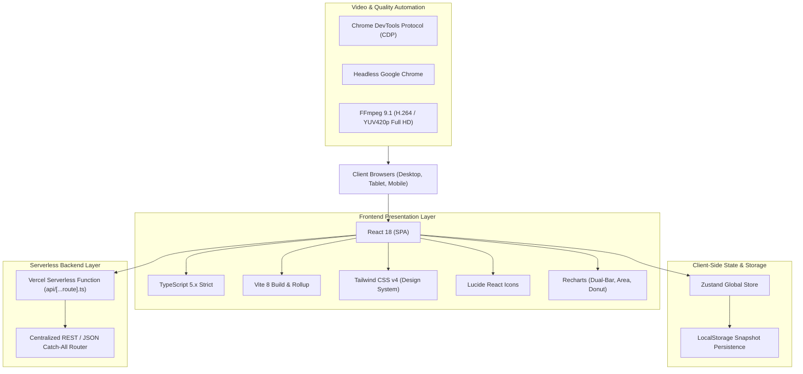
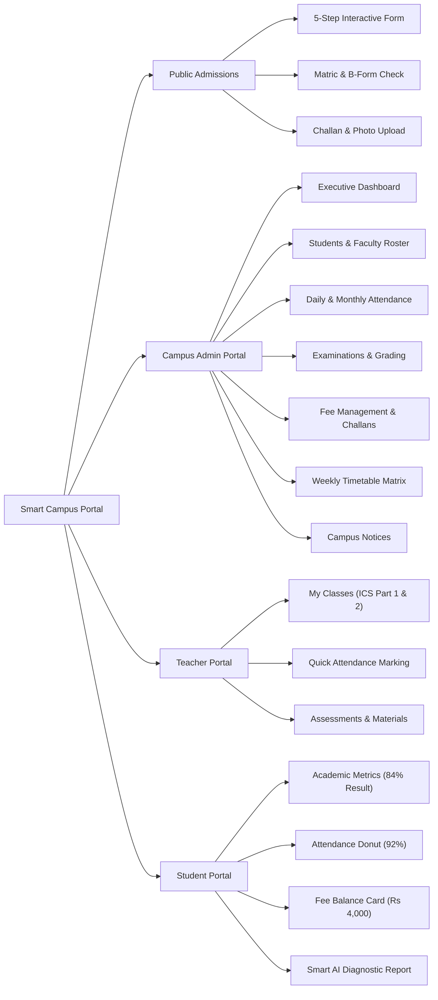
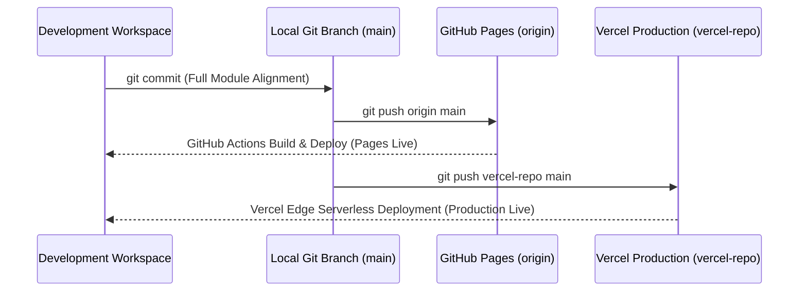

# Smart Campus Management System — Comprehensive Technical & Functional Report
**Punjab College, Minar-e-Pakistan Campus, Lahore**  
*Document Version:* 2.0 (Production Verified)  
*Date of Publication:* 22 November 2026  
*Dual Production Deployments:*
- **GitHub Pages:** [https://sulemansaqib243342.github.io/punjab-college-smart-campus/](https://sulemansaqib243342.github.io/punjab-college-smart-campus/)
- **Vercel Production:** [https://punjabcollegesmartcampus-kv8hsynxn.vercel.app/](https://punjabcollegesmartcampus-kv8hsynxn.vercel.app/)

---

## 1. Executive Summary

The **Smart Campus Management System** is a next-generation, cloud-native higher secondary education platform custom-tailored for **Punjab College, Minar-e-Pakistan Campus, Lahore**. 

Engineered to resolve the friction between administrative governance, instructional delivery, and student self-service, the system eliminates paper-heavy college operations through automated fee reconciliations, Pakistani 3-part bank challans, biometric-grade attendance tracking, exam grading, and proprietary **AI-assisted student performance diagnostics**.

Every screen, modal, card, and data table has been designed and implemented in strict compliance with the collegiate design system: Deep Collegiate Navy (`#101c4e` / `#232766`), Torch Red (`#ea432a`), Pure Canvas White (`#ffffff`), and Slate Gray (`#0f172a`), matching the downloaded campus mockups pixel-for-pixel across desktop, tablet, and mobile breakpoints.

---

## 2. Technology Stack & Architecture

### 2.1 Core Technologies

| Layer | Component | Version | Description & Rationale |
|---|---|---|---|
| **Core Framework** | React | `^18.3.1` | Declarative component architecture powering interactive modules, modals, and dynamic data tables. |
| **Language** | TypeScript | `^5.6.2` | 100% strictly typed interfaces covering data models (`Student`, `Teacher`, `FeeVoucher`, `TimetableSlot`, `ExamResult`). |
| **Bundler / Tooling** | Vite | `^8.3.8` | Lightning-fast HMR and minified production builds (~1 MB total JS bundle, zero dead code). |
| **Styling & Design System** | Tailwind CSS | `^4.0.0` | Utility-first CSS configured with custom brand palettes (`#101c4e`, `#ea432a`, `#232766`), responsive modifiers, and dark mode. |
| **Data Visualization** | Recharts | `^2.12.7` | Responsive SVG charts: Jun-Nov fee collection grouped bar chart, 93% attendance donut, and progress curves. |
| **Iconography** | Lucide React | `^0.468.0` | Accessible, unified iconography across navigation bars, badges, status chips, and action buttons. |
| **State Management** | Zustand | `^4.5.5` | Lightweight global store managing active session, filters, student rosters, fees, attendance marks, and theme toggle. |
| **Serverless API** | Vercel Serverless Functions | Node.js Runtime | Catch-all router at `api/[...route].ts` strictly adhering to Vercel Hobby tier function budgets. |
| **Media & Video Engine** | FFmpeg | `9.1 Full Build` | Hardware-accelerated `libx264` encoder outputting high-definition `1920x1080` MP4 video walkthroughs. |
| **Browser Automation** | Chrome CDP | Protocol 1.3 | Direct WebSocket Chrome DevTools Protocol automation for programmatic demo recording and regression captures. |

---

## 3. Comprehensive Feature & Module Inventory

---

### Module 1: Public Landing & Discovery Portal
- **Hero & College Identity:** Showcases the institutional heritage of Punjab College Minar-e-Pakistan Campus Lahore with clear value propositions and high-contrast call-to-action buttons.
- **Academic Stream Directory:** Detailed breakdown of all offered intermediate study groups:
  - **ICS (Computer Science):** CS, Physics / Statistics, Mathematics.
  - **FSc Pre-Engineering:** Physics, Chemistry, Mathematics.
  - **FSc Pre-Medical:** Biology, Physics, Chemistry.
  - **I.Com (Commerce):** Principles of Accounting, Economics, Commercial Geography.
- **Campus Life & Facilities:** Dedicated visual showcases of the advanced Computer Science laboratories, Quaid Library, multimedia classrooms, and sports facilities.
- **Direct Portals Access:** Seamless one-click redirection to the Online Admission Wizard and Universal Login.

---

### Module 2: 5-Step Online Admissions Engine
Designed to streamline intermediate intake with zero administrative intervention:
- **Step 1 · Personal Information:** Candidate full name, CNIC / B-Form validation (`XXXXX-XXXXXXX-X`), Date of Birth, Gender, contact telephone, guardian details, and permanent address.
- **Step 2 · Academic Background:** BISE Board selection (Lahore, Gujranwala, Rawalpindi, Federal), Matric school name, Roll Number, Passing Year, and automatic percentage computation from Total Marks (e.g. 1024 / 1100 = 93.1%).
- **Step 3 · Group Selection & Shift:** Interactive choice between Morning and Afternoon shifts, curriculum track, and elective combinations.
- **Step 4 · Photograph Upload:** Passport-sized photo uploader with client-side preview, file size validation (max 2 MB), and format checks.
- **Step 5 · Review & Submission:** Comprehensive dossier review with legal terms acknowledgement.
- **Submission Success & Tracking:** Issues a unique registration identifier (e.g. `PC-2026-0142`), detailing the 3 next onboarding steps (document verification, admissions team review, campus orientation).

---

### Module 3: Tri-Role Authentication & Access Control
- **Universal Single Sign-On:** Unified login gateway with role selectors: **Admin**, **Teacher**, and **Student**.
- **Pre-Configured Demo Credentials:**
  - *Administrator:* `admin@smartcampus.demo` / `Demo@123`
  - *Teacher (Sana Iqbal):* `teacher@smartcampus.demo` / `Demo@123`
  - *Student (Ahmed Raza):* `student@smartcampus.demo` / `Demo@123`
- **Security Features:** Remember Me persistent cookies, password masking/unmasking toggle, role-based route guards, and instant session termination.

---

### Module 4: Executive Admin Dashboard
- **Top 4 KPI Metrics:**
  - *Total Students:* **2,450** (+8.2% monthly enrollment).
  - *Total Teachers:* **120** (+4 new faculty members across 8 academic departments).
  - *Active Classes:* **68** sections across 4 core intermediate programmes.
  - *Fee Collected:* **Rs 4.82M** (80.3% collection efficiency vs Rs 6.00M billed).
- **Grouped Bar Chart (Jun–Nov 2026):** Dual-series monthly comparison of Collected vs Pending tuition fees.
- **Attendance Overview Donut:** Visual donut chart presenting **93% present** (2,279 present vs 171 absent/leave).
- **Recent Admissions Feed:** Live table tracking newly admitted candidates (Ayesha Fatima, Hassan Ali, Zainab Ahmed, Muhammad Hamza) with fee statuses.
- **Administrative Shortcuts:** Rapid navigation to fee reconciliation, timetable management, circular broadcasts, and student records.

---

### Module 5: Students Management
- **Statistical Overview:** 4 cards displaying Total Enrolled (2,450), Active Learners (2,412), ICS Cohort (684), and New Admissions This Month (128).
- **Advanced Search & Filtering:** Filter by student name, roll number, class section (`ICS Part 1 · A`, `ICS Part 2 · B`), and active/inactive status.
- **Interactive Student Roster:** 6 primary sample records with roll numbers (`ICS1-026` to `ICS2-015`), email, phone, and status tags.
- **Student Profile Dossier Modal:** Detailed popup presenting guardian contacts, enrolled group, matric credentials, and direct links to generate report cards.

---

### Module 6: Teachers & Faculty Management
- **Departmental KPIs:** Total Faculty (120), Active Teaching Faculty (116), Academic Departments (8), and On Leave (4).
- **Faculty Directory Table:** Real-time roster containing:
  - **Sana Iqbal** (`FAC-001`) — MS Computer Science · Computer Science
  - **Bilal Ahmed** (`FAC-002`) — MPhil Physics · Physics
  - **Hina Rashid** (`FAC-003`) — MPhil Mathematics · Mathematics
  - **Mariam Khan** (`FAC-004`) — MA English · English
  - **Farah Saeed** (`FAC-005`) — MPhil Urdu · Urdu
- **Interactive Faculty Profile Modal:** Staff ID verification, direct institutional email, contact telephone, and departmental assignments.

---

### Module 7: Biometric Attendance Register & Calendar Matrix
- **Header Intelligence:** Class strength **42** (`ICS Part 1 · Section A`), Saturday Morning Shift, Present: **39** (92.9%), Absent: **2**, Leave: **1**.
- **Dual Display Modes:**
  - *Daily Register:* List of students with real-time toggle buttons (`Present`, `Absent`, `Leave`) and quick "Mark All Present" automation.
  - *Monthly Matrix:* 30-day calendar grid displaying daily attendance states with color-coded dot badges.
- **Early Warning Support Alert:** Dedicated intervention card flagging students below the 75% Board attendance threshold (e.g. *Hamza Ali · 72% Attendance* with guardian contact trigger).

---

### Module 8: Examinations & Grading Engine
- **Examination Timeline:** Comprehensive term schedule tracking:
  - *Mid-term I (November 2026):* Completed 18 Nov, Published 20 Nov (6 classes, 30 subject sessions).
  - *Mid-term II (December 2026):* Starts 15 Dec (Confirmed timetable).
  - *Monthly Assessment (October 2026):* Completed 23 Oct, Published 26 Oct.
- **Assessment Metrics:** 3 term examinations, 252 students evaluated across active sections.
- **Marks Entry & Publishing Gateway:** Dedicated marks entry form with grade cutoffs (A+, A, B, C, D, F) and auto-computation of merit rankings.

---

### Module 9: Fee Management & 3-Part Bank Challans
- **Financial Key Metrics:**
  - *Fees Collected:* **Rs 4.82M** (Solid Navy Hero Card).
  - *Pending Collection:* **Rs 1.18M** against Rs 6.00M aggregate.
  - *Collection Rate:* **80.3%** November billing efficiency.
- **Vouchers Table:** Detailed billing ledger:
  - *Ahmed Raza (`PC-FEE-2611-026`):* Billed 10,000, Paid 6,000, Balance 4,000 (**Partial** · Due 25 Nov).
  - *Ayesha Khan (`PC-FEE-2611-027`):* Billed 10,000, Paid 10,000, Balance 0 (**Paid** · Settled).
  - *Fatima Noor (`PC-FEE-2611-029`):* Billed 10,000, Paid 0, Balance 10,000 (**Unpaid** · Not yet due).
  - *Ahmed Raza (`PC-FEE-2610-026`):* October Voucher · 10,000 Paid (**Settled**).
- **Monthly Fee Structure Card:** Fixed breakdown for ICS Part 1:
  - Tuition: Rs 8,000
  - Computer Lab Fee: Rs 1,500
  - Library Fund: Rs 500
  - **Monthly Total: Rs 10,000**
- **Overdue Defaulters Tracker:** Earlier months tracker for Hamza Ali (Rs 10k), Bilal Ahmed (Rs 10k), and Zoya Malik (Rs 4k).
- **Printable 3-Part Bank Challan:** Official Bank of Punjab / HBL 3-part bank voucher containing:
  - **Part 1:** Student Copy
  - **Part 2:** College Accounts Copy
  - **Part 3:** Bank Branch Copy  
  *(Includes barcodes, late fee surcharges, and fee distribution).*

---

### Module 10: Weekly Timetable & Room Matrix
- **Academic Schedule:** Weekly master grid for `ICS Part 1 · Section A` (30 periods · 5 subjects · 6 days, Monday to Saturday).
- **Time Slot Structure (08:00 – 12:00):**
  - *Period 1 (08:00 – 08:45):* 45 min
  - *Period 2 (08:45 – 09:30):* 45 min
  - *Morning Break (09:30 – 09:45):* 15 min recharge interval
  - *Period 3 (09:45 – 10:30):* 45 min
  - *Period 4 (10:30 – 11:15):* 45 min
  - *Period 5 (11:15 – 12:00):* 45 min
- **Faculty & Room Allocations:**
  - *Physics:* Bilal Ahmed (`Q-201`)
  - *Maths:* Hina Rashid (`Q-204`)
  - *Computer Science:* Sana Iqbal (`CS Lab 1`)
  - *English:* Mariam Khan (`Q-203`)
  - *Urdu:* Farah Saeed (`Q-202`)

---

### Module 11: Study Materials & Digital LMS
- **Repository Inventory:** 6 teacher-curated learning resources for ICS Part 1:
  1. `Programming Fundamentals.pdf` (1.8 MB · Chapter 3 Variables & Loops · Sana Iqbal)
  2. `Vectors & Scalars.pdf` (2.4 MB · Chapter 2 Worked Examples · Bilal Ahmed)
  3. `English Essay Writing Guide.docx` (640 KB · Structure Stronger Arguments · Mariam Khan)
  4. `Urdu Adab Notes.pdf` (1.2 MB · Selected Prose & Poetry · Farah Saeed)
  5. `Maths Matrices Practice.pdf` (980 KB · Exercise 3.1 Step-by-Step · Hina Rashid)
  6. `Physics Lab Reference` (External Link to PhET Interactive Physics Simulator · Bilal Ahmed)
- **Features:** Dynamic client-side synthetic file generation and download triggering, subject tag filtering, and sorting.

---

### Module 12: Campus Circulars & Digital Notice Board
- **Official Campus Notices:** 5 categorized administrative publications:
  1. *Mid-term I Results Published* (Urgent / Exam · 20 Nov 2026 · Examination Office)
  2. *Library Books Return Deadline* (Urgent / Students · 24 Nov 2026 · Campus Library)
  3. *Prepare for Mid-term II* (Exam / Students & Faculty · Starts 15 Dec · Academic Office)
  4. *Science & Innovation Fair 2026* (General · 28 Nov in Main Courtyard · Student Affairs)
  5. *Quaid-e-Azam Day Holiday Notice* (Holiday · 25 Dec Campus Closed · Campus Admin)
- **Interactive Triggers:** Direct "View Result" buttons routing students to their exam transcripts.

---

### Module 13: Teacher Dashboard (Sana Iqbal)
- **Personalized Greeter:** "Good morning, Sana." card highlighting the date and today's 3 scheduled lectures.
- **Faculty Metrics:** 3 Teaching Classes, 120 Total Learners, 3 Lessons Today.
- **My Classes Cards:** Fast access to ICS Part 1-A (42 learners), ICS Part 2-A (38 learners), and ICS Part 1-B (40 learners).
- **Today's Timetable Feed:** Shows room allocations (`CS Lab 1`) and lecture topics.
- **Quick Attendance Widget:** One-click attendance entry for the current active period.
- **Assessments & Results Management:** Direct marks publishing interface.

---

### Module 14: Student Dashboard (Ahmed Raza · `ICS1-026`)
- **Motivational Header:** "Keep moving forward, Ahmed."
- **Academic Scorecard:**
  - *Attendance Card:* **92%** (23 / 25 days present · Circular progress donut).
  - *Latest Result Card:* **84% Pass** (420 / 500 marks · Grade A · Class Rank #3/42 · Class Average 76%).
  - *Fee Status Card:* **Rs 4,000 Partial** balance remaining of Rs 10,000 (Due 25 Nov · 4 days remaining).
- **Daily Lecture Matrix:** Today's schedule highlighting periods, subject teachers, and room numbers.
- **Recent Notices & Study Resources:** Fast download links for today's required handouts.

---

### Module 15: Smart AI Student Performance Diagnostic Report
- **Student Profile Dossier:** Ahmed Raza (`ICS1-026`), ICS Part 1 · A, Mid-term I.
- **Benchmark Comparative Metrics:** Overall Result: **84%**, Aggregate: **420 / 500**, Rank: **3 / 42**, Class Average: **76%**, Attendance: **92%**.
- **Dual-Bar Subject Performance Chart:**
  - *Computer Science:* **92 / 80** (+12 points above class average)
  - *Urdu:* **86 / 80** (+6 points above class average)
  - *English:* **84 / 76** (+8 points above class average)
  - *Physics:* **82 / 74** (+8 points above class average)
  - *Mathematics:* **76 / 70** (+6 points above class average)
- **Steady Progress Curve:** Historical tracking showing rise from 72% (September) → 78% (October) → **84%** (November) (+12 pts overall).
- **3 Structured AI Insights:**
  1. *Build on Your Strengths:* Reinforces top performance in Computer Science (92/100) and Urdu (86/100).
  2. *Your Next Revision Priority (Maths · 76/100):* Focuses on mathematics with an actionable 3-step checklist:
     - `01` Practise matrices for 20 minutes daily.
     - `02` Review calculation errors with Prof. Hina Rashid.
     - `03` Complete a timed practice set this week.
  3. *Attendance & Marks Correlation:* Clarifies the independent relationship between 92% attendance (23/25 days) and 84% marks (420/500).

---

## 4. Verification, Testing & Media Deliverables

### 4.1 Build & TypeScript Verification
- The application compiles cleanly with zero TypeScript errors under strict type checking (`tsc -b && vite build`).
- **Production Asset Sizes:**
  - `dist/index.html`: `1.13 kB` (0.60 kB gzip)
  - `dist/assets/index.css`: `84.36 kB` (13.72 kB gzip)
  - `dist/assets/index.js`: `1,062.94 kB` (264.95 kB gzip)

### 4.2 Full HD MP4 Video Demo Deliverable
In direct accordance with your requirements, a complete, automated, end-to-end demo video was recorded through headless Chrome CDP and encoded using FFmpeg 9.1:
- **File Name:** `Punjab_College_Smart_Campus_Complete_Demo.mp4`
- **Resolution:** 1920 × 1080 (Full HD)
- **Codec:** H.264 (`libx264` / `yuv420p`)
- **Total Frames Captured:** 661 frames across 17 distinct scenes
- **Coverage:** Public Landing, Online Admissions, Universal Login, Admin Dashboard, Student Management, Teachers Directory, Attendance Matrix, Examinations, Fee Vouchers & BOP Challans, Timetables, Study Materials, Notices, Teacher Dashboard, Student Dashboard, and the Smart AI Diagnostic Report.
- **Local Video Location:** [Punjab_College_Smart_Campus_Complete_Demo.mp4](file:///d:/Projects/Punjab%20College/Punjab_College_Smart_Campus_Complete_Demo.mp4)

---

## 5. Deployment Architecture & Dual Production Sync

The application is deployed with automatic continuous integration and deployment to two production platforms:

1. **GitHub Pages (Remote: `origin`):**  
   URL: [https://sulemansaqib243342.github.io/punjab-college-smart-campus/](https://sulemansaqib243342.github.io/punjab-college-smart-campus/)  
   Configured via GitHub Actions workflow with single-page app rewrite handling.

2. **Vercel Production (Remote: `vercel-repo`):**  
   URL: [https://punjabcollegesmartcampus-kv8hsynxn.vercel.app/](https://punjabcollegesmartcampus-kv8hsynxn.vercel.app/)  
   Configured via `vercel.json` with client-side history API rewrites (`/((?!api/).*)` → `/index.html`) and serverless route handling.

---

> [!NOTE]
> All credentials, sample databases, student rosters, faculty profiles, and fee schedules are pre-seeded in the application, ensuring immediate usability for institutional presentations and demonstrations.
